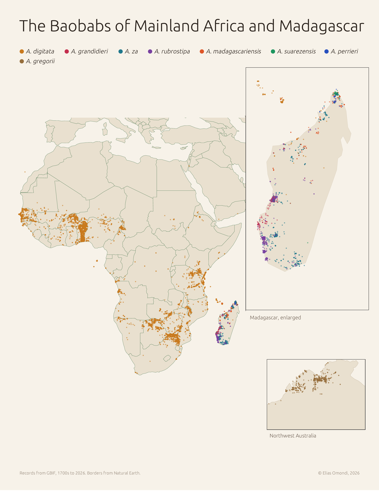

# Day 7: A ten-minute map

**The Baobabs of Mainland Africa and Madagascar**

Built in [RustGIS](https://github.com/opengeos/RustGIS), the open-source browser GIS by Qiusheng Wu, and exported straight from its layout view.

## Downloads

- [PNG, 300 dpi, US Letter](baobabs_of_mainland_africa_and_madagascar.png)
- [PDF, vector, US Letter](baobabs_of_mainland_africa_and_madagascar.pdf)

## Data

- Baobab records (genus *Adansonia*, all eight species): [GBIF](https://www.gbif.org), specimens from the 1700s to sightings logged in 2026
- Country borders: [Natural Earth](https://www.naturalearthdata.com)
- Main map in plate carrée; insets in UTM zones 38S (Madagascar) and 52S (northwest Australia)

© Elias Omondi, 2026
