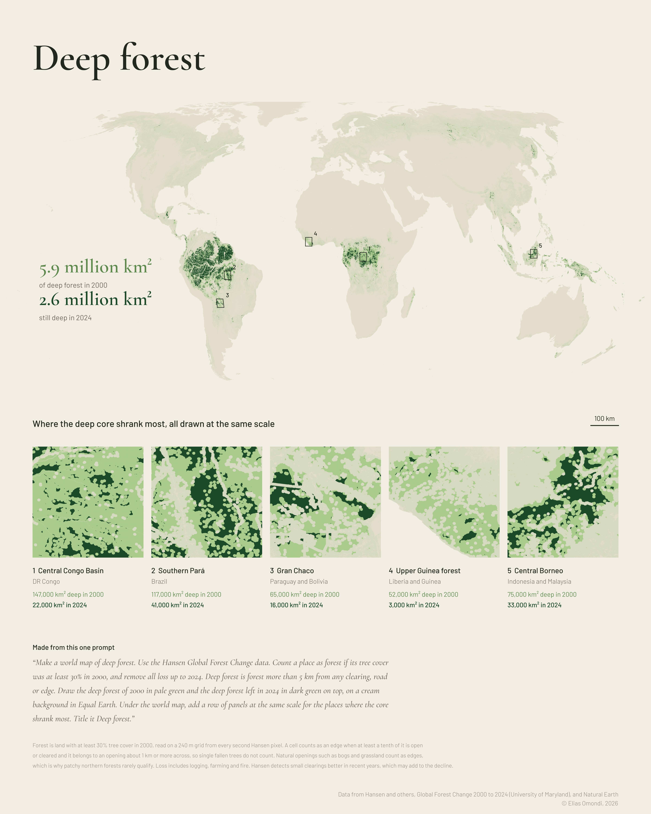

# Day 10: Prompting only

**Deep forest**

Made from a single prompt to Claude Opus 5.5 in the Claude desktop app, with no hands on the data. The prompt is printed on the map, word for word.

Deep forest is forest more than 5 km from any clearing, road or edge. In 2000 the world had about 5.9 million km² of it, and by 2024 about 2.6 million km² was left.

## Download

- [PNG, full resolution (4800 × 6000)](deep_forest.png)

## Data and method

- Forest and forest loss: Hansen and others, [Global Forest Change 2000 to 2024](https://developers.google.com/earth-engine/datasets/catalog/UMD_hansen_global_forest_change_2024_v1_12) (University of Maryland), v1.12
- Coastlines: [Natural Earth](https://www.naturalearthdata.com)
- Forest is land with at least 30% tree cover in 2000, read on a 240 m grid from every second Hansen pixel. A cell counts as an edge when at least a tenth of it is open or cleared and it belongs to an opening about 1 km or more across. Water is not counted as an edge.
- Run in Google Earth Engine.

© Elias Omondi, 2026
