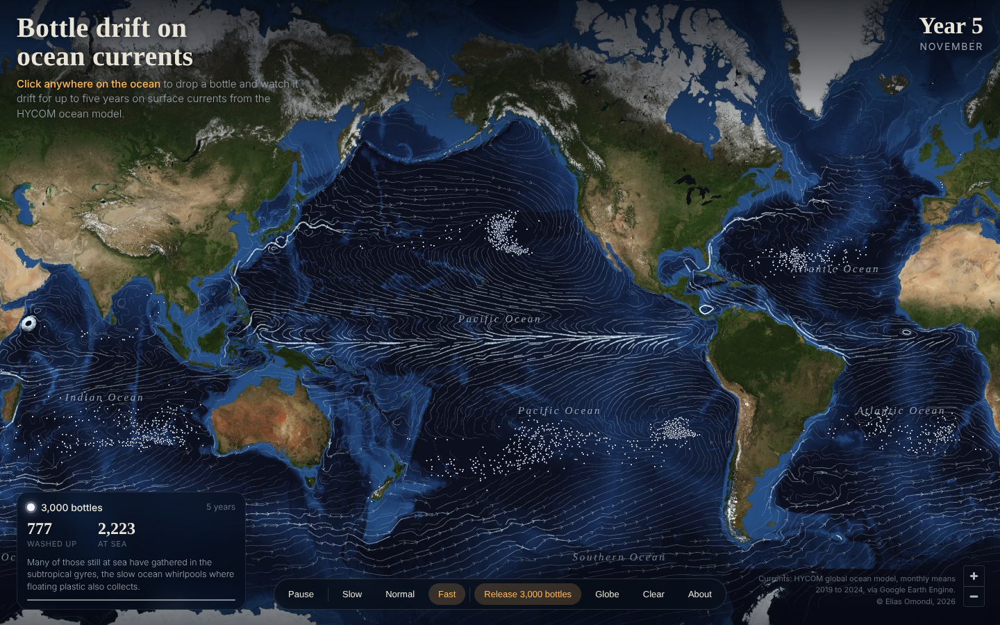

# Day 13: Interactive

**Bottle drift on ocean currents**

**[Open the interactive map: ocean-bottles.github.io](https://ocean-bottles.github.io)**

Click anywhere on the ocean to drop 15 bottles and watch them drift for up to five years on real surface currents. Each drop gets a card that tracks how many bottles have washed up, how many are still at sea and how far the farthest has travelled. The "Release 3,000 bottles" button seeds bottles across every ocean, and after five simulated years the ones still at sea have gathered in the five subtropical gyres, the slow ocean whirlpools where floating plastic also collects. The picture above is that run.

## Data and method

- Currents: HYCOM global ocean model, surface velocity ([`HYCOM/sea_water_velocity`](https://developers.google.com/earth-engine/datasets/catalog/HYCOM_sea_water_velocity) in Google Earth Engine), averaged for each calendar month from September 2019 to August 2024 on a 0.25° grid between 80°N and 78°S
- Each simulated day a bottle moves with the current where it sits, plus a small random step for the eddies that monthly averages smooth away. A bottle pushed against the coast has a small daily chance of washing up. Wind is left out, so the paths show where the water itself would carry a bottle.
- Basemap: NASA Blue Marble Next Generation with bathymetry. Coastlines and countries: [Natural Earth](https://www.naturalearthdata.com). Map library: MapLibre GL JS.
- Code and data: [github.com/ocean-bottles/ocean-bottles.github.io](https://github.com/ocean-bottles/ocean-bottles.github.io)

© Elias Omondi, 2026
